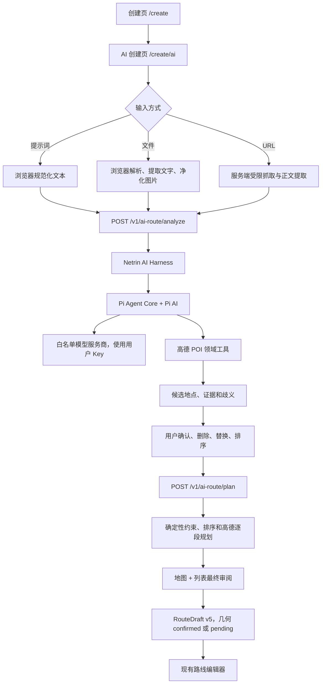

# AI 导览路线生成：M9 / R5 实施文档

> 状态：Provider 1.3.0 已于 2026-08-14 部署；2026-08-15 已发布同源 AI 入口静态修复并通过全新 Chromium 生产烟测；服务端文件与受限自定义端点、官家人工生产烟测均已验证，现仅余隐私、第三方服务披露与专业复核
> 编写日期：2026-07-29
> 面向对象：下一开发窗口
> 实施批次：M9 / R5 `AI Route Authoring`
> 本文性质：实施规格、历史设计与生产实施记录；标为 1.2 历史的视觉/URL/聚合路由章节不得用于当前实现

> **2026-08-14 代码收敛：仓库契约已升级为 1.3.0。** 模型视觉、受限 URL 抓取与 OpenRouter
> 动态目录已从产品范围移除；浏览器仅保留文本+文件（PDF/DOCX/TXT/MD，魔数校验）输入，
> `plugins/cell-plugins.json` 与 AI 能力 mock 已删除 `fetch-url` / `vision` 能力，OpenRouter
> 与视觉标识进入构建秘密扫描禁项。下文关于视觉、URL、OpenRouter 的章节（如输入类型表、
> Provider 目录、开关清单与 8.4 视觉费用说明）为 1.2 历史记录，不再反映当前实现；
> 当前契约以 `plugins/cell-plugins.json`（1.3.0）、服务端注册表和 `scripts/lib/ai-capabilities-mock.mjs` 为准。

> 生产实施记录（2026-08-14）：Orchestrator 镜像 `0.1.0-r5-text-20260814` 只监听
> `127.0.0.1:8787`；公网 Nginx 精确代理 providers/analyze/plan/model-catalog/provider-probe，
> `/analyze` 为 1 MiB、目录与探测为 32 KiB，并使用独立限速。文件与自定义开关已开启；
> Docker 出站只允许公网 TCP 443，拒绝私网/保留地址/HTTP。注册表 200、未鉴权 401、未知路径
> 404 和真实 `deepseek-v4-pro` 官方直连 200 已验证；**官家人工生产烟测通过**，不再等待、索取或伪造 JWT。
> 静态入口差异已修复：空 `VITE_AI_ROUTE_API_BASE` 明确表示同源 `/v1/ai-route/*`，页面依据运行时 providers 能力显示 AI 入口并提供失败重试；常规本地 `dev` / `preview` 默认接入确定性同源 mock，避免被忽略的 `.env.local` 污染。发布前仍须在部署者自己的环境复验创作入口、受保护接口、未知路径与容器健康状态。

> 2026-08-03 的 Provider 1.2 视觉、URL 与聚合路由方案仅为历史设计，已被 1.3 全面取代。
> 本文尚保留少量带“历史”标识的旧章节作为决策档案；任何当前实现、部署或验收均不得引用它们。

## 1. 结论与已定决策

本功能在现有“创建路线”页增加一个主入口，让用户通过以下两种方式生成导览路线：

1. 输入一段自然语言，描述城市、时长、主题、偏好和限制。
2. 导入带文字层的 PDF、DOCX、Markdown 或纯文本，由本地预处理提取地点线索。扫描 PDF 拒绝；混合 PDF 只采用文字页并提示警告。

核心原则是：

> AI 负责理解意图、提出地点候选与语义顺序；高德负责确认真实地点和道路；用户负责处理歧义并最终确认。

已确定的技术取舍如下：

- 使用独立 Node.js 服务 `netrin-ai-orchestrator`，不把 Agent 运行时放入 Supabase Edge Function。
- Agent 运行时采用 Pi 的 `pi-agent-core + pi-ai`，不部署完整 Pi Coding Agent CLI。
- 只给 Agent 暴露路线领域工具，不提供 Shell、文件写入、任意网络请求或通用 HTTP 工具。
- 用户自带大模型 API Key（BYOK）；浏览器只在当前页面进程内存中持有，刷新或关闭页面后即丢失；服务端只在请求作用域中持有。Key 不进入 Web Storage、数据库、IndexedDB、Service Worker、日志、指标或草稿，退出登录或鉴权失败也会清除内存 Key。
- 保留 DeepSeek/Qwen/Kimi 固定注册表；自定义端点只允许公网域名、HTTPS 默认 443 与 OpenAI Chat Completions 兼容接口。不支持聚合路由、URL 抓取、图片或视觉消息。
- PDF/DOCX 文字提取在用户设备完成；不运行浏览器或服务端文字识别模型。
- 不单独建设“原型阶段”和大型评测平台；把约 16 个固定案例直接放入自动化测试。
- 不做灰度发布。内部验收通过后直接发布，但必须保留可独立于容器和前端生效的服务端紧急开关。
- AI 生成的坐标不得直接来自模型；所有最终坐标必须来自高德 POI 查询结果，并按项目既有规则转为 WGS-84。
- AI 生成的路线几何不得直接由模型绘制；必须由高德路径规划产生，并经用户明确确认后才可成为 `confirmed` 几何。

## 2. 与现有 Netrin 的关系

实现时仍须服从仓库根目录 `AGENTS.md` 规定的来源优先级：

`Neuron Markdown kernel → NEURON_CELL.md → neuron.manifest.json → code`

当前可复用的基础能力：

- [`../src/screens/CreateScreen.tsx`](../src/screens/CreateScreen.tsx)：现有创建入口，包含地图规划、现场记录和文件导入。
- [`../src/data/types.ts`](../src/data/types.ts)：当前 `RouteDraft` 为 v5（兼容迁移 v4），`authoringMode` 为 `map | field | import | ai`。
- [`../src/data/drafts.ts`](../src/data/drafts.ts)：草稿规范化、迁移和 IndexedDB 持久化入口。
- [`../src/lib/amap/routePlanning.ts`](../src/lib/amap/routePlanning.ts)：调用 `netrin-route-plan`、校验 WGS-84 路线和规划相邻点路段。
- [`../src/lib/amap/useRoutePreview.ts`](../src/lib/amap/useRoutePreview.ts)：现有路线预览状态管理。
- [`../supabase/functions/netrin-route-plan/core.ts`](../supabase/functions/netrin-route-plan/core.ts)：WGS-84/GCJ-02 边界转换与高德步行、骑行规划。
- [`../plugins/cell-plugins.json`](../plugins/cell-plugins.json)：现有 `route-import-dendrite` 与 `ai-route-cortex` 契约。

本功能作为独立的 M9 / R5 功能列车实现。Provider 1.3 与同源静态入口已经上线；当前支持提示词和 TXT/MD/DOCX/带文字层 PDF，不支持 URL、视觉、OCR 或聚合模型目录。产品内的静态服务、隐私与第三方说明必须随实际能力维护，专业复核属于运营事项，不是启用开关。

## 3. 范围与非目标

### 3.1 MVP 范围

- 两类输入：提示词、受限文本文件。
- 约束提取：城市/区域、交通方式、可用时间、主题、必去地点、避开项、起终点偏好。
- 地点候选生成与高德 POI 消歧。
- 用户选择歧义项、删除、替换和排序地点。
- 计算可执行顺序、逐段规划路线、展示总里程和预计耗时。
- 将确认结果转换成现有路线草稿并进入既有编辑器。
- 中文默认、英文备用，所有界面文案通过 `t('...')`。
- BYOK 服务商选择、模型能力校验和安全错误提示。

### 3.2 明确不做

- 不做全网旅行搜索、热点发现或“附近有什么”的搜索产品。
- 不依赖Bing、Google 或其他搜索 API。
- 不用 Playwright、Crawl4AI、Firecrawl 等浏览器自动化抓取受限内容。
- 不尝试绕过登录、验证码、反爬或平台访问限制。
- 不支持模型生成并直接落库经纬度。
- 不让 Agent 调用 Shell、任意 URL、任意数据库、文件系统写入或代码执行工具。
- 不保存用户的大模型 API Key。
- 不保存用户上传的原文件、URL 正文、完整提示词、文档正文或规范化图片。
- 不提供后台长记忆、Agent 会话恢复或跨用户共享会话。
- 不支持 HTTP、本机/局域网、IP 字面量、非 443 端口、自定义 Header、原生 Anthropic/Gemini、Ollama、LM Studio 或任意接口路径。
- 不把现有 GPX/GeoJSON 导入并入 AI 流程；它继续使用专用导入入口。

## 4. 用户流程与界面

### 4.1 创建页入口

在现有创建页三个入口上方增加一张主卡：

- 标题：`AI 生成路线`
- 说明：`从描述、链接或资料中整理地点，并生成可编辑路线`
- 动作：进入 `/create/ai`

现有地图规划、现场记录和 GPX/GeoJSON 导入保持不变。AI 功能关闭或服务不可用时，只隐藏 AI 卡片，不影响本地创建能力。

### 4.2 AI 创建页

页面采用三种输入方式的切换控件：

1. `描述旅程`
2. `粘贴链接`
3. `导入资料`

输入区下方始终显示关键约束，允许用户在 AI 分析前主动填写：

- 城市或区域：必填；若正文能够可靠识别，可让用户一键确认。
- 交通方式：步行优先，后续可选骑行。
- 可用时间：分钟或小时。
- 起点/终点：可空；支持“同起终点”。
- 最多地点数：默认 6，范围 2–10。
- 偏好：自然、植物、历史、建筑、亲子、无障碍等。
- 必去与避开：自由文本。

大模型设置折叠在“AI 服务”区域：

- 固定服务商下拉框。
- 模型下拉框，只显示通过能力矩阵验证的模型。
- API Key 密码输入框。
- 明示：`密钥会经 Netrin 服务转发给所选模型服务商，仅用于本次生成，不会保存。`
- 第一版不提供“记住密钥”。

### 4.3 结果审阅

结果页同时展示地图和有序地点列表。每个地点显示：

- 地点名称与类别。
- 简短入选理由。
- 来源证据摘要。
- 置信度：高、中、低。
- 高德确认状态。
- 预计停留时长。
- 删除、替换、上移、下移。

若一个地点存在多个高德候选，必须进入“待确认”状态，由用户选择。不得静默采用低置信度候选。

路线预览显示：

- 预计总路程和总时长。
- 各段路径规划状态。
- 超出用户时间或距离预算的警告。
- 未能规划的路段及其处理建议。

用户点击“创建草稿”前必须勾选或点击明确确认动作。确认后把结果转换为路线草稿，进入现有 `/create/:draftId` 编辑器继续修改、添加图片和发布。

### 4.4 状态与错误

前端至少覆盖以下状态：

- 等待输入。
- 本地解析文件。
- 正在分析意图。
- 正在确认地点。
- 等待用户处理歧义。
- 正在计算顺序。
- 正在规划道路。
- 等待最终确认。
- 用户取消。
- API Key 无效或额度不足。
- 模型不支持工具调用或图片输入。
- 文件不受支持、过大、解析为空。
- URL 被安全策略拒绝、无法访问或正文为空。
- 城市缺失或地点跨城。
- 高德无匹配、路线不可达或服务超时。
- 执行预算耗尽。

服务端只返回稳定错误码和安全摘要；界面通过 i18n 错误键展示，不直接输出模型服务商的原始错误正文。

## 5. 总体架构



建议目录结构：

```text
src/
  screens/
    AiRouteCreateScreen.tsx
  components/ai-route/
    AiInputModeTabs.tsx
    AiProviderFields.tsx
    AiConstraintFields.tsx
    AiCandidateList.tsx
    AiAmbiguityPicker.tsx
    AiRouteReview.tsx
  lib/ai-route/
    contracts.ts
    client.ts
    providerCapabilities.ts
    filePreprocess.ts
    imagePreprocess.ts
    draftAdapter.ts
    errors.ts
  data/
    ai-route-fixtures/

services/
  netrin-ai-orchestrator/
    package.json
    Dockerfile
    src/
      server.ts
      config.ts
      contracts/
      routes/analyze.ts
      routes/plan.ts
      harness/
        routeAgent.ts
        stateMachine.ts
        budgets.ts
        validators.ts
        systemPrompt.ts
      providers/
        piAdapter.ts
        registry.ts
        credentialScope.ts
      tools/
        searchPois.ts
        getPoiDetails.ts
        submitRoutePlan.ts
        planRouteSegments.ts
      input/
        fetchPublicUrl.ts
        extractReadableHtml.ts
      observability/
        safeMetrics.ts
        redaction.ts
    test/
```

服务端目录可在实现时按现有 monorepo 工具调整，但责任边界不得合并回浏览器或 Supabase Edge Function。

## 6. 路线 Agent Harness

### 6.1 Pi 的职责

使用：

- `@earendil-works/pi-agent-core`
- `@earendil-works/pi-ai`

截至 2026-07-29，Pi 仓库位于 `earendil-works/pi`，包仍在快速变化。实现前再次核对包名与 Node 要求，锁定精确版本，并在 `providers/piAdapter.ts` 后面隔离 Pi API，避免业务代码直接依赖其易变接口。

只使用 Pi 的通用 Agent 循环、模型适配和工具调用能力。不要引入完整 Coding Agent 的会话、文件、Shell 或编辑器工具。

### 6.2 领域工具白名单

第一版 Agent 仅能看到以下工具：

| 工具 | 作用 | 关键限制 |
|---|---|---|
| `search_pois` | 按城市、名称、别名和类型查询高德 POI | 城市必填；限制返回数量；不得接受模型提供坐标 |
| `get_poi_details` | 获取一个候选 POI 的规范名称、类别和位置 | 只接受前一工具产生的受信 POI 标识 |
| `evaluate_route` | 估算候选顺序是否满足主题、时间和地点数限制 | 只读；不产生路线几何 |
| `submit_route_plan` | 提交结构化语义方案，结束 Agent 循环 | 严格 JSON Schema；提交后仍由服务端验证 |

最终道路规划不必开放给模型反复调用。`/plan` 阶段由确定性程序调用高德规划，可减少费用、工具循环和不可预测性。

### 6.3 状态机

状态由 Harness 控制，不由提示词自由决定：

```text
received
  -> normalized
  -> constraints_extracted
  -> poi_candidates
  -> ambiguity_pending | resolved
  -> ordered
  -> route_planned
  -> user_review
  -> draft_created
```

每次状态转换都必须有显式输入、校验条件和错误出口。模型只能在允许的状态中产生下一步结构化建议。

### 6.4 初始执行预算

首版采用保守硬上限：

- 每次分析最多 8 个模型回合。
- 最多 12 次 POI 搜索调用。
- 最多 10 个最终关键点。
- Agent 分析最长 60 秒，完整请求最长 90 秒。
- 每个用户最多 1 个并发 AI 请求。
- 仅对明确的瞬时网络错误重试 1 次。
- 对输入字符、图片数量、模型输出 Token 和工具结果大小分别限额。
- 达到任一上限立即返回稳定的 `AI_BUDGET_EXHAUSTED`，不得无限自我修复。

这些限制由代码计数器和超时器执行，不能只写在系统提示词里。

### 6.5 提示词注入防护

- URL 正文、文档正文和图片内容全部标记为“不可信来源资料”。
- 使用清晰的结构边界包裹来源资料，明确其内容只能用于提取事实和偏好。
- 来源中的“忽略以上要求”“调用工具”“输出密钥”等文字一律视作正文，不视作指令。
- Agent 没有通用 HTTP、Shell、环境变量、数据库或文件写入工具，因此即使被注入也不能扩权。
- `submit_route_plan` 后由独立验证器重新检查城市、POI 来源、坐标、数量、预算和字段长度。
- 工具返回仅含完成当前决策所需字段，不向模型暴露高德密钥、用户 JWT 或其他内部配置。

## 7. 关键点生成与路线设计

### 7.1 模型先产生“地点意图”，不产生坐标

模型输出的初始候选应类似：

```ts
type PlaceIntent = {
  candidateId: string
  desiredName: string
  aliases: string[]
  cityHint: string
  categoryHint?: string
  reason: string
  evidence: string
  priority: 'required' | 'preferred' | 'optional'
  estimatedStayMinutes?: number
  preferredPeriod?: 'morning' | 'afternoon' | 'evening'
}
```

此结构中故意没有经纬度。模型给出的任何坐标字段都应被 Schema 拒绝。

### 7.2 POI 解析

1. 先确认唯一城市或有限区域；无法确认时先询问用户。
2. 使用 `desiredName + aliases + categoryHint + city` 调用高德 POI 搜索。
3. 对返回结果计算名称相似度、类别一致性、城市一致性和与已确认地点的空间合理性。
4. 高置信度且明显唯一的候选可预选，但仍在结果页展示。
5. 多个结果接近、跨行政区或名称冲突时，返回 `ambiguity_pending`。
6. 用户选择后再获取 POI 详情，得到受信的 GCJ-02 坐标，并在 Provider 边界转为 WGS-84。
7. POI 标识、地址和搜索词只用于当前运行，不写入路线草稿，延续当前地图规划的最小持久化原则。

### 7.3 地点筛选与排序

先应用硬约束：

- 城市和区域。
- 必去、避开。
- 最大地点数。
- 交通方式。
- 开放时段信息只有在有可靠数据时才使用；不可让模型臆测营业时间。
- 无障碍等安全相关要求只能作为候选过滤提示，必须明确数据可能不完整。

再应用软目标：

- 与主题和用户偏好的相关性。
- 地点多样性，避免同质 POI 堆叠。
- 语义顺序，例如“先观察整体，再进入细节”。
- 地理紧凑度。
- 停留时间与移动时间的平衡。

模型可提出语义顺序和优先级，程序用距离矩阵生成初始顺序，再用确定性局部优化（如 2-opt）降低明显绕路。若优化会破坏必去顺序或用户锁定顺序，则保留用户约束。

### 7.4 时间与距离超限

规划完成后重新计算总移动时间和停留时间：

1. 若在预算内，进入最终审阅。
2. 若轻微超限，先尝试调整可交换地点顺序。
3. 仍超限时，从最低优先级的 `optional` 地点开始提出删除建议。
4. 没有可删除地点时，把超限事实展示给用户，不擅自删除 `required` 地点。

### 7.5 几何确认

- 相邻关键点调用既有高德路线规划能力。
- 路线返回后必须通过现有 WGS-84 范围、点数和距离校验。
- 高德失败时可以在审阅页显示虚线直连作为临时诊断，但不得把它标记为已确认的 AI 路线几何。
- 若用户仍选择创建草稿，应保存关键点并保持几何为 `pending`，进入现有编辑器后重新规划。
- 只有高德产生且用户明确确认的路线才能写为：
  - `geometrySource: 'amap-planned'`
  - `geometryStatus: 'confirmed'`

## 8. 输入处理

### 8.1 提示词

提示词直接在浏览器做长度裁剪和 Unicode 规范化。建议上限 20,000 字符。不得把历史输入自动追加到新请求。

如果提示词缺少城市，优先让用户补充，而不是让模型跨全国猜测同名地点。

### 8.2 文件白名单

V1 接受：

| 类型 | 扩展名 | 处理方式 |
|---|---|---|
| 图片 | `.jpg` `.jpeg` `.png` `.webp` | 本地缩放、压缩、移除 EXIF；交给用户选择的视觉模型 |
| PDF | `.pdf` | PDF.js 本地抽取文字；仅将低文字量页面渲染、净化后交给视觉模型 |
| Word | `.docx` | Mammoth `extractRawText({ arrayBuffer })`；不渲染未净化 HTML |
| 纯文本 | `.txt` | 本地读取、编码校验、长度裁剪 |
| Markdown | `.md` | 按纯文本读取，不执行 HTML、脚本或外部资源 |

V1 明确拒绝：

- `.docm`
- `.xls` `.xlsx`
- `.ppt` `.pptx`
- `.html` `.htm` `.mhtml`
- `.svg`
- `.zip` `.rar` `.7z` 及其他压缩包
- `.gif`
- 音频、视频
- 可执行文件、安装包和脚本文件

HEIC 不作为直接输入类型。后续若确有需求，只允许浏览器本地转 JPEG，并在转码时移除 EXIF。

### 8.3 文件限制

初始限制：

- 单个文档不超过 10 MiB。
- PDF 不超过 30 页。
- 单次文件总大小不超过 10 MiB。
- 最终提交给模型的规范化文本不超过约 100,000 字符，并按证据相关性裁剪。

前后端都要验证 MIME、扩展名、魔数、大小和数量。不能只信浏览器的 `accept`。

解析放入 Web Worker，设置超时和内存保护，防止超大页面、压缩炸弹和主线程卡死。

### 8.4 扫描与混合 PDF

Netrin 不提供浏览器本地或服务端文字识别，也不把页面渲染为图片交给模型。带文字层 PDF 由 PDF.js 在浏览器抽取文字；纯扫描 PDF 明确拒绝并提示改用带文字层版本。混合 PDF 只采用可抽取文字的页面，并向用户显示被跳过页面警告。URL、图片与视觉输入不属于 1.3 契约。

## 9. BYOK 与模型服务商

### 9.1 凭据生命周期

- API Key 从密码框通过 HTTPS 传到 `analyze` 请求。
- 服务端创建 request-scoped credential closure，仅传给本次 Pi provider adapter。
- Key 不进入全局环境变量、Pi `auth.json`、数据库、缓存、队列或 Agent 消息历史。
- 请求完成、取消或超时后，相关引用立即释放。
- 日志中禁止记录 Authorization、请求体、Provider 请求头和原始错误对象。
- 前端不得写入 localStorage、IndexedDB、URL、Service Worker、崩溃报告或埋点。
- Key 只在当前标签页会话内记住：刷新后恢复，关闭标签页、退出登录或鉴权失败后清除。

### 9.2 服务商注册表

服务端维护固定注册表，字段至少包括：

```ts
type ProviderCapabilities = {
  providerId: string
  allowedModelIds: string[]
  modelSource: 'fixed'
  toolCalling: boolean
  maxContextTokens: number
  supportsThinking: boolean
}
```

固定注册表保留三项：DeepSeek 中国区文本模型
`deepseek-v4-flash` / `deepseek-v4-pro`；Qwen 中国区固定百炼兼容端点与
`qwen3.8-max` / `qwen3.7-max` / `qwen3.7-plus` / `qwen3.7-flash` / `qwen3.6-plus` / `qwen3.6-flash`；
Kimi 中国区固定 `https://api.moonshot.cn/v1` 与 `kimi-k3` / `kimi-k2.7-code-highspeed` /
`kimi-k2.7-code` / `kimi-k2.6`。所有登记模型只声明文本与工具调用；运行时能力与前端门禁由同一固定注册表产生。若模型不支持工具调用，禁止开始生成。

### 9.3 自定义兼容端点的受限边界

Provider 1.3 允许用户配置 OpenAI Chat Completions 兼容 Base URL；生产能力开关已开启：

- Base URL 只允许无凭据、无查询/片段、无编码路径穿越的公网域名 HTTPS，端口必须为 443；可保留规范化路径，例如 `/v1`。
- `/models` 失败时前端允许手填模型 ID；首次分析前必须做不含用户内容的最小强制工具调用探测。
- 通过探测后服务端签发一小时令牌，绑定用户、规范化 Base URL、模型和 API Key 的 HMAC 标签；任何绑定项变化或令牌过期都必须重新探测。
- Pi 只接收 `127.0.0.1` 随机端口上的短时租约 URL。回环代理重新解析全部 DNS，混合公私结果整体拒绝，并把 TLS/SNI/证书校验连接钉在已验证公网 IP；仅代理 `GET /models` 与 `POST /chat/completions`，不跟随重定向。
- 代理仅重建 Bearer、JSON 必要头，拒绝 Cookie、Referer、代理头、压缩响应和用户自定义 Header；请求/响应均有严格小体积与超时边界，取消立即关闭上下游。
- 浏览器显示规范化 ASCII 域名，并要求每个浏览器会话确认 Key 与文字将发送给该主机。非秘密配置最多十项保存到 IndexedDB；Key 不随配置保存。

生产 Docker 出站层已拒绝私网、宿主机网段、链路本地、云元数据与非 443 目标；systemd 在 Docker 后恢复并验证规则。

## 10. API 契约

契约 `1.3.0` 采用“两阶段、无服务端会话持久化”，并提供两个独立鉴权配置接口：

1. `/analyze`：理解来源、生成地点意图、调用 POI 工具、返回候选和歧义。
2. 用户在浏览器确认候选。
3. `/plan`：重新验证用户选择的 POI，做确定性排序和高德逐段规划，返回可审阅路线。
4. `/model-catalog`：只读取自定义端点模型目录。
5. `/provider-probe`：对自定义端点执行最小文本工具探测并返回短时绑定令牌。

这样无需保持长时间 Agent 会话，也不需要 Redis 或数据库任务表。浏览器只保存非密钥的中间候选；服务重启不会泄露或遗留用户资料。

### 10.1 `POST /v1/ai-route/analyze`

> 下方大段 TypeScript 是 Provider 1.2 历史结构，仅保留作迁移对照，**不得实现或发送其中的 `openrouter`、`url`、图片、视觉或 multipart 字段**。Provider 1.3 的规范结构以 `services/netrin-ai-orchestrator/src/contracts/aiRoute.ts` 和 `src/lib/ai-route/contracts.ts` 为准：请求为 JSON，Provider 仅固定三家或 `custom-openai`，输入仅 `prompt | file`；文件只发送本地抽取且裁剪后的文字与安全来源摘要，原文件字节、图片和页面渲染永不上传。

要求：

- Supabase 用户 JWT。
- 用户账号已完成手机号验证。
- `application/json`，Nginx `/analyze` 请求体上限 1 MiB。
- 仅本次请求携带用户 API Key。

请求逻辑结构：

```ts
type AnalyzeRequest = {
  provider:
    | { providerId: 'deepseek-cn' | 'qwen-cn' | 'kimi-cn'; modelId: string; apiKey: string }
    | { providerId: 'openrouter'; modelId: string; apiKey: string; dataCollection: 'allow' | 'deny' }
    | { providerId: 'custom-openai'; modelId: string; apiKey: string; baseUrl: string; capabilityToken: string }
  input:
    | { kind: 'prompt'; text: string }
    | { kind: 'url'; url: string }
    | {
        kind: 'file'
        extractedText: string
        sourceFiles: Array<{
          displayName: string
          mediaType: string
          byteSize: number
        }>
        imageRecognition?: 'provider-vision'
        imagePartIds?: string[]
      }
  constraints: {
    region: string
    travelMode: 'walking' | 'cycling'
    durationMinutes?: number
    maximumStops: number
    startHint?: string
    endHint?: string
    roundTrip?: boolean
    mustInclude?: string[]
    avoid?: string[]
    preferences?: string[]
  }
  locale: 'zh-CN' | 'en'
}
```

响应：

```ts
type AnalyzeResponse = {
  requestId: string
  inputSummary: {
    kind: 'prompt' | 'file' | 'url'
    sourceRefs: Array<
      | { kind: 'file'; displayName: string }
      | { kind: 'url'; origin: string; title?: string }
    >
  }
  normalizedConstraints: Record<string, unknown>
  candidates: Array<{
    candidateId: string
    placeIntent: PlaceIntent
    confidence: 'high' | 'medium' | 'low'
    options: Array<{
      optionRef: string
      poiName: string
      category?: string
      district?: string
      displayAddress?: string
      wgs84: [number, number]
    }>
    selectedOptionRef?: string
    requiresUserChoice: boolean
  }>
  proposedOrder: string[]
  warnings: string[]
}
```

坐标虽然返回给浏览器用于预览，但必须由 POI 工具产生。服务端应在内部记录坐标来源标签，不能接受模型提交的坐标。

`optionRef` 是由服务端签名、短时有效的 opaque token，内部关联高德 POI 标识、城市和到期时间；前端不解析。建议有效期 15 分钟。这样 `/plan` 不需要保存 Agent 会话，也能验证候选确实来自本次受信 POI 查询。签名密钥只在 Orchestrator 环境变量中，绝不暴露给 Agent 或前端。

### 10.2 `POST /v1/ai-route/plan`

`/plan` 不需要大模型 API Key。它重新读取高德 POI 详情，验证候选没有被客户端伪造，然后做确定性规划。

```ts
type PlanRequest = {
  analyzeRequestId: string
  constraints: AnalyzeRequest['constraints']
  selectedStops: Array<{
    candidateId: string
    optionRef: string
    intent: {
      reason: string
      priority: 'required' | 'preferred' | 'optional'
    }
    userLockedOrder?: number
    estimatedStayMinutes?: number
  }>
  proposedOrder: string[]
}
```

响应：

```ts
type PlanResponse = {
  requestId: string
  stops: Array<{
    candidateId: string
    name: string
    reason: string
    wgs84: [number, number]
    estimatedStayMinutes?: number
  }>
  geometryCandidate?: GeoJSON.LineString
  geometrySource?: 'amap-planned'
  distanceMeters?: number
  walkingOrCyclingMinutes?: number
  totalEstimatedMinutes?: number
  warnings: string[]
  canConfirmGeometry: boolean
}
```

`analyzeRequestId` 只用于关联安全日志和指标，不代表服务端保存 Agent 会话。`/plan` 验证 `optionRef` 的签名和有效期，再用其中的受信 POI 标识重新读取详情。客户端回传的 `intent` 只用于显示与排序，其长度和枚举必须重新校验，不能改变 POI 坐标。

### 10.3 取消和超时

前端使用 `AbortController` 取消请求。服务端把取消信号传到 Pi provider 和高德请求，并停止后续工具调用；被取消的请求不重试。

## 11. 草稿契约与持久化

实现时把路线草稿从 v4 升级到 v5：

```ts
type AuthoringMode = 'map' | 'field' | 'import' | 'ai'

type AiGenerationProvenance = {
  inputKind: 'prompt' | 'url' | 'file'
  providerId: string
  modelId: string
  generatedAt: string
  sourceRefs: Array<{
    kind: 'url-origin' | 'page-title' | 'file-name'
    label: string
  }>
  candidateCount: number
  ambiguityCount: number
  harnessVersion: string
  promptVersion: string
}
```

约束：

- `sourceRefs` 只保存 URL origin、页面标题或本地文件名，不保存完整 URL、正文或图片。
- 不保存 API Key。
- 不保存完整模型请求、响应或工具轨迹。
- `providerId`、`modelId` 只用于可解释性，不可反推出 Key。
- AI 关键点转换为现有 `RecordedPoint[]`：
  - `rawPosition` 和最终位置都来自已确认的 WGS-84 POI。
  - `snapped` 为 `false`，除非后续用户在现有编辑器明确进行道路吸附。
  - 标题使用确认后的 POI 名称。
  - 描述使用通过长度和内容校验的入选理由。
  - 媒体数组初始为空。
- 只有 `canConfirmGeometry=true` 且用户确认后，才把 `geometryCandidate` 写入正式几何并设为 `confirmed`。
- 路线不可达时可以只保存关键点，几何保持 `pending`。

需要补齐：

- v4 → v5 无损迁移。
- v5 规范化和异常数据回退。
- AI provenance 的单元测试。
- 旧草稿加载、编辑、保存和发布回归测试。

## 12. Cell 插件和 Manifest

建议在 [`../plugins/cell-plugins.json`](../plugins/cell-plugins.json) 中新增 cell-local 插件：

```text
id: ai-route-cortex
proposed capabilities:
  route.ai.extract
  route.ai.resolve-poi
  route.ai.order
  route.ai.review
```

能力名为当前提案，实施前须按现有插件 Schema 校验。URL 和文件的入口组织可以复用 `route-import-dendrite` 的导入概念，但 AI 分析、POI 消歧和路线审阅属于新的 `ai-route-cortex`，不要改变现有 GPX/GeoJSON 行为。

同时更新：

- `neuron.manifest.json`：声明新入口和能力，界面仍由 manifest 驱动。
- i18n：补齐中英文文案和稳定错误码。
- `PLAN.md`：实际开始 M9 时再记录里程碑状态。
- `AGENT_BRIEF.md`：AI 页面、草稿 v5 或后端状态真正改变后再更新。
- `SERVER.md`：只有服务实际部署或服务器配置实际改变，并由官家报告执行结果后才更新。

## 13. 安全、隐私和滥用控制

### 13.1 服务端保护

- AI API 要求已登录且手机号已验证，避免匿名滥用服务器和高德配额。
- 按用户和 IP 限流；第一版每个用户仅 1 个并发请求。
- 全链路请求体上限、超时、工具次数和模型 Token 上限。
- 只允许固定前端 Origin。
- AMap Web Service Key 只存在服务端环境变量。
- 不需要、也不得把 Supabase `service_role` 暴露给前端或 Agent。
- 响应头禁止缓存含用户资料的 AI 结果。
- 健康检查不得输出环境变量、服务商配置详情或密钥状态。

### 13.2 日志与指标

允许记录：

- `requestId`
- 用户的不可逆匿名标识
- 阶段耗时
- 稳定错误码
- `providerId`、`modelId`
- 模型回合数、工具调用数
- 候选数、歧义数
- 是否预算耗尽
- 成功/失败

禁止记录：

- API Key、Authorization、Cookie
- 原始提示词
- URL 正文、完整目标 URL 查询参数
- 文件名中的敏感路径、文档正文、图片
- POI 精确坐标和完整行程
- 模型原始请求/响应
- 服务商原始错误对象

### 13.3 合规提示

当前静态说明页应明确：

- 用户选择的第三方大模型服务商会收到相应输入。
- API Key 会经 Netrin 服务转发但不会保存。
- 文件内容应由用户拥有相应使用权；本版本不读取 URL。
- AI 建议可能错误，路线发布前由用户负责确认。

AI 入口由 Manifest 与运行时 Provider registry 能力共同决定；registry 不可达时显示可重试不可用态，但不阻断三种手工创作入口。

## 14. 测试策略

不建设独立评测平台。固定、可重复的案例直接进入仓库测试：

- 4 个提示词案例：清晰城市、同名地点、时间超限、必去/避开冲突。
- 文件案例：文本 PDF、扫描 PDF 拒绝、DOCX、TXT/MD、超限与异常文档。
- Provider 案例：固定三家、受限自定义、模型目录/探测、能力不可用和上游错误分类。
- 安全案例：提示词注入、模型伪造坐标、工具预算耗尽、SSRF 边界和 Key/日志泄露检查。

测试分层：

### 14.1 单元测试

- 输入规范化和长度限制。
- 文件类型、魔数、大小和页数校验。
- URL/IP/重定向/Content-Type 安全校验。
- Provider 能力矩阵。
- 状态机非法转换。
- 预算计数和取消。
- POI 匹配置信度与歧义阈值。
- 排序、2-opt、时间预算和可选点删除建议。
- RouteDraft v4 → v5 迁移与 AI adapter。
- 日志脱敏。

### 14.2 Agent 契约测试

使用 Pi 的 faux provider 或等价测试 provider，固定模型输出和工具轨迹，验证：

- Agent 只能调用白名单工具。
- 未经 `search_pois`/`get_poi_details` 产生的坐标被拒绝。
- 注入文本不能改变系统目标。
- 超过回合或工具预算时确定性停止。
- `submit_route_plan` Schema 不合法时只允许有限修复。

### 14.3 集成测试

- Mock 高德 POI 和路线规划响应。
- `/analyze` 从三种输入得到结构化候选。
- 用户处理歧义后 `/plan` 重新验证 POI。
- 高德失败时不得产生 `confirmed` 几何。
- API Key 不进入持久化、日志和错误响应。

### 14.4 浏览器与回归测试

- 390×844 主视口。
- 输入模式切换、取消、重试、离线/弱网状态。
- 用户调整地点顺序与删除地点。
- 创建 v5 草稿并进入现有编辑器。
- 旧 v4 草稿继续工作。
- 中英文文案、键盘操作、焦点、错误提示和无障碍标签。

最终仍执行项目既有门禁：

```text
npm run validate:cell
npm run typecheck
npm run test
npm run build
npm run scan:dist
npm run test:smoke
```

服务端另执行自己的 typecheck、unit、integration、container build 和依赖漏洞扫描。

## 15. 分阶段实施步骤

### 阶段 0：契约与骨架

1. 在 `PLAN.md` 登记独立 M9 / R5 边界，不耦合数据库或其他发布列车。
2. 更新 manifest 和 `cell-plugins.json` 的 AI 能力契约。
3. 定义前后端共享的 `AnalyzeRequest/Response`、`PlanRequest/Response`、错误码和 Provider 能力结构。
4. 创建约 16 个固定案例；它们是自动化测试夹具，不另建原型工程。
5. 创建 `services/netrin-ai-orchestrator`、健康检查、配置校验、Dockerfile 和安全日志骨架。
6. 锁定 Pi 精确版本，完成 `piAdapter`，用 faux provider 通过最小工具循环测试。

完成标准：不调用真实模型也能用固定响应完整跑通状态机、预算终止和错误映射。

### 阶段 1：提示词 BYOK 最小闭环

1. 完成固定服务商注册表和 request-scoped Key。
2. 实现 `/analyze` 的提示词输入。
3. 实现 `search_pois`、`get_poi_details`、`submit_route_plan`。
4. 建立地点意图 Schema、坐标来源校验和歧义返回。
5. 实现 `/plan` 的确定性筛选、排序和高德逐段规划。
6. 创建 `/create/ai`，先只开放“描述旅程”。
7. 显示候选、歧义、地图预览和最终确认。

完成标准：用户用自己的 Key，从中文描述生成一条由高德确认 POI 和道路、可进入现有编辑器的路线。

### 阶段 2：草稿 v5 与现有编辑器集成

1. 增加 `authoringMode: 'ai'` 和 `AiGenerationProvenance`。
2. 实现 v4 → v5 迁移。
3. 实现 `draftAdapter.ts`。
4. 确认关键点、几何候选和 `confirmed/pending` 状态转换。
5. 回归地图规划、现场记录、文件导入和旧草稿。

完成标准：AI 草稿可重复打开、编辑、保存和按既有流程发布，其他创建方式无回归。

### 阶段 3：文件本地预处理

**仓库状态（2026-08-03）：已实现，默认能力开关关闭，未生产启用。**

1. 增加文件白名单和双端校验。
2. 接入 PDF.js、Mammoth、图片缩放/压缩/EXIF 清除。
3. 把解析工作放入 Web Worker。
4. 不接入浏览器或服务端文字识别模型，避免语言模型下载、设备算力和服务端费用。
5. 图片与低文字量 PDF 页面只提供用户显式选择的模型视觉路径。
6. 验证低文字量 PDF 页面选择，避免整份 PDF 视觉上传。

完成标准：受支持文件可以在限制内稳定产生规范化文本或压缩图片，原文件和 Key 均不落库。

### 阶段 4：URL 尽力抓取

**仓库状态（2026-08-03）：已实现，默认能力开关关闭，未生产启用。**

1. 实现 HTTPS、DNS/IP、重定向、超时、大小和 Content-Type 校验。
2. 使用 Readability 做正文提取和净化。
3. 增加动态/登录/反爬页面失败后的分享文本与截图引导。
4. 补齐 SSRF、DNS rebinding、超大响应、重定向链和提示词注入测试。
5. 不接搜索服务，不接浏览器自动化。

完成标准：普通公开静态文章可进入同一分析流程；受限页面安全失败并给出可执行的替代方法。

### 阶段 5：安全、验收与直接发布

**生产状态（2026-08-15）：Provider 1.3 容器、出站防火墙、Nginx 与服务端文件/自定义开关已发布；同源 AI 静态入口已修复，全新 Chromium 与官家人工生产烟测均通过。现仅余隐私、第三方服务披露与专业复核。**

1. 完成错误码、脱敏、限流、取消、超时和预算测试。
2. 检查构建产物、全部浏览器持久化存储、日志和崩溃报告中没有 Key 或来源正文；Key 只可存在于当前页面进程与活动请求内存。
3. 用固定案例完成内部验收。
4. 完成隐私政策、用户协议和第三方服务披露。
5. 构建并部署 `netrin-ai-orchestrator` 容器、反向代理与出站防火墙配置。
6. 根据实际部署结果更新 `SERVER.md` 变更日志。
7. 直接发布，不做灰度；保留 Nginx 503 紧急开关。

## 16. 部署建议

`netrin-ai-orchestrator` 作为自托管 Supabase 同服务器上的独立容器运行：

- Node 版本满足锁定 Pi 包的要求；截至本文日期需重点核对 Node `>=22.19.0`。
- 反向代理精确公开 `/providers`、`/analyze`、`/plan`、`/model-catalog` 与 `/provider-probe`；未声明子路径返回 404。
- 固定 Provider 只访问代码锁定域名；自定义端点已受 Docker 出站层私网/元数据/非 443 阻断保护。
- 环境变量只包含服务配置、`AMAP_WEB_SERVICE_KEY` 和轮换管理的 `AI_ROUTE_OPTION_SIGNING_KEY`，不包含用户模型 Key。
- 配置 `AI_ROUTE_ENABLED` 紧急开关。
- 文件与自定义端点分别由 `AI_ROUTE_FILE_ENABLED`、`AI_ROUTE_CUSTOM_PROVIDER_ENABLED` 控制，生产现均为 `true`，可独立回滚。
- `/v1/ai-route/analyze` 的 Nginx 请求体上限为 1 MiB；`/plan` 为 256 KiB，目录与探测为 32 KiB。
- 反向代理和应用日志关闭请求体记录，对相关 Header 做脱敏。
- 请求超时应略高于 Harness 的 90 秒上限，但不得无限等待。
- 健康检查只返回版本、状态和时间，不返回配置。

高德道路规划应尽量复用现有 `netrin-route-plan` 契约和 WGS/GCJ 转换测试，避免出现第二套坐标逻辑。实施时优先方案是由 Orchestrator 携带当前用户 JWT 调用已部署的 `netrin-route-plan` HTTP 接口；若现有 Origin/鉴权契约不允许，再抽取环境无关的纯转换与校验模块。不要复制一份无人同步的坐标算法。

## 17. 验收标准

功能只有同时满足以下条件才可启用：

- 固定案例中的高置信度 POI 精确率达到 95% 以上。
- 所有低置信度或多候选地点都展示给用户确认。
- 持久化数据中模型生成坐标为零。
- 所有 `confirmed` 路线几何都来自高德规划且有用户确认动作。
- 不支持的文件在浏览器和服务端均被拒绝。
- 自定义端点通过 SSRF、DNS rebinding、固定 IP/TLS SNI、默认 443、大小和超时测试。
- 来源资料中的提示词注入不能获得额外工具或绕过 Schema。
- API Key 只允许出现在当前页面进程和活动请求内存中；不得进入 sessionStorage、localStorage、IndexedDB、Service Worker、数据库、草稿、日志、指标、错误响应或构建产物。
- Agent 达到回合、工具、Token 或时间预算时可确定性终止。
- 390×844 下输入、歧义处理、路线审阅和确认流程可用。
- 中英文、键盘操作、焦点和错误提示完整。
- v4 草稿和三种现有创建方式无回归。
- 项目既有门禁与服务端测试全部通过。
- 法务披露完成，生产紧急开关可用。

## 18. 阶段 3—5 之后的受控发布顺序

2026-08-14 受控发布按以下顺序推进；已完成项与阻塞项以 `SERVER.md` 为准：

1. 重新阅读根 `AGENTS.md` 要求的全部规格和本文件。
2. 检查工作区未提交改动，避免覆盖现有修改。
3. 已完成生产备份、暗部署、Docker 出站阻断、Nginx 1 MiB/32 KiB 边界与公网拒绝路径验证。
4. 已原子发布静态站并开启文件与自定义端点；保留 503 总开关和旧镜像/静态 release 回滚点。
5. ✅ 官家已使用真实生产会话完成固定 Provider 路线生成的人工生产烟测；验收事实记录为“官家人工生产烟测通过”。不得为重复证明而索取或伪造 JWT。
6. 390×844 主要页面、云路线、详情、媒体、账号/管理/外观与 HTTP 边界应在每次发布中复验；静态 AI 创作入口差异已由当前源码修复，不得从本文推断某一生产环境已部署该修复。
7. 完成隐私、用户协议和第三方模型披露的专业复核；草案编辑不等于复核完成。
8. 每次真实服务器变更后按核验结果更新 `SERVER.md`；不要扩展搜索、URL 抓取、视觉或浏览器自动化。

任何阶段若发现 Pi 包接口已变化，只修改 `piAdapter`；任何模型服务商差异只修改 Provider registry/adapter；任何高德差异只修改领域工具或既有路线服务边界。不得让这些变化扩散进页面和草稿数据模型。

## 19. 参考资料

- [Pi Agent Core README](https://github.com/earendil-works/pi/blob/main/packages/agent/README.md)
- [Pi AI README](https://github.com/earendil-works/pi/blob/main/packages/ai/README.md)
- [Pi Agent package.json](https://github.com/earendil-works/pi/blob/main/packages/agent/package.json)
- [Mozilla PDF.js](https://github.com/mozilla/pdf.js)
- [Mammoth.js](https://github.com/mwilliamson/mammoth.js)
- [Mozilla Readability](https://github.com/mozilla/readability)
- [OWASP SSRF Prevention Cheat Sheet](https://cheatsheetseries.owasp.org/cheatsheets/Server_Side_Request_Forgery_Prevention_Cheat_Sheet.html)
- [OWASP File Upload Cheat Sheet](https://cheatsheetseries.owasp.org/cheatsheets/File_Upload_Cheat_Sheet.html)
- [OpenRouter provider routing and data policy](https://openrouter.ai/docs/guides/routing/provider-selection)
- [OpenRouter model catalog](https://openrouter.ai/docs/guides/overview/models)
- [LibreChat custom endpoint configuration](https://www.librechat.ai/en/docs/configuration/librechat_yaml/object_structure/custom_endpoint)
- [ETOS LLM Studio](https://github.com/Eric-Terminal/ETOS-LLM-Studio)（仅产品交互参考；GPL-3.0 代码未复制到本 MIT 项目）
- [OWASP LLM Prompt Injection](https://genai.owasp.org/llmrisk/llm01-prompt-injection/)
